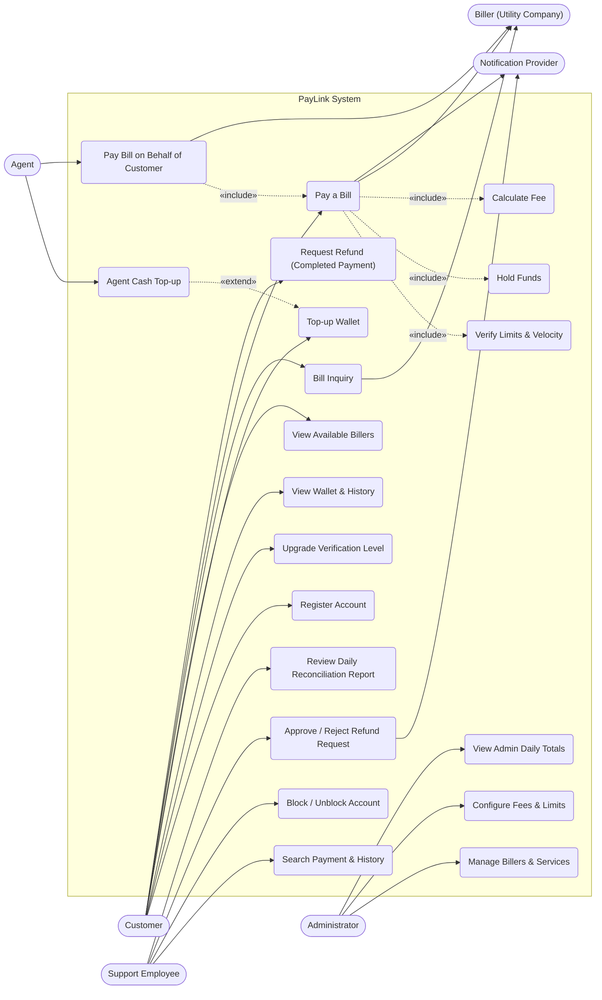
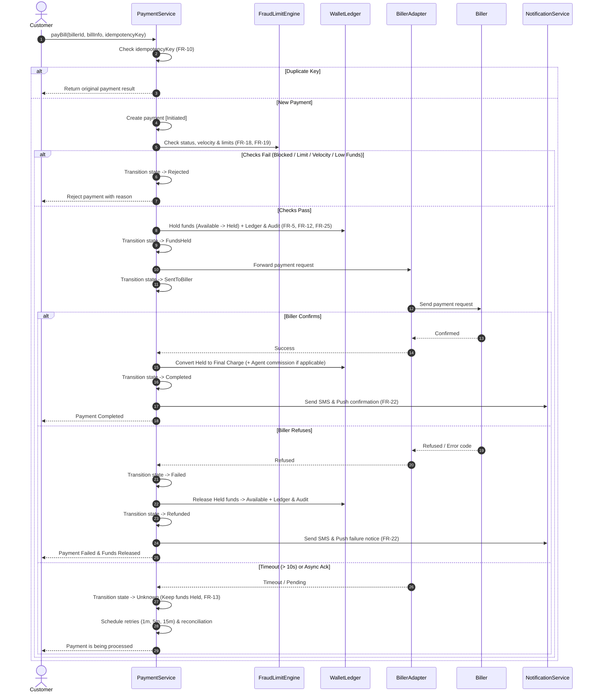
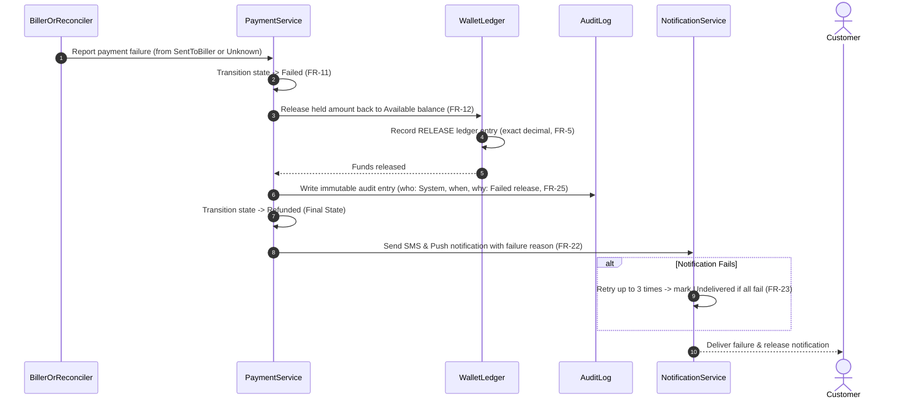
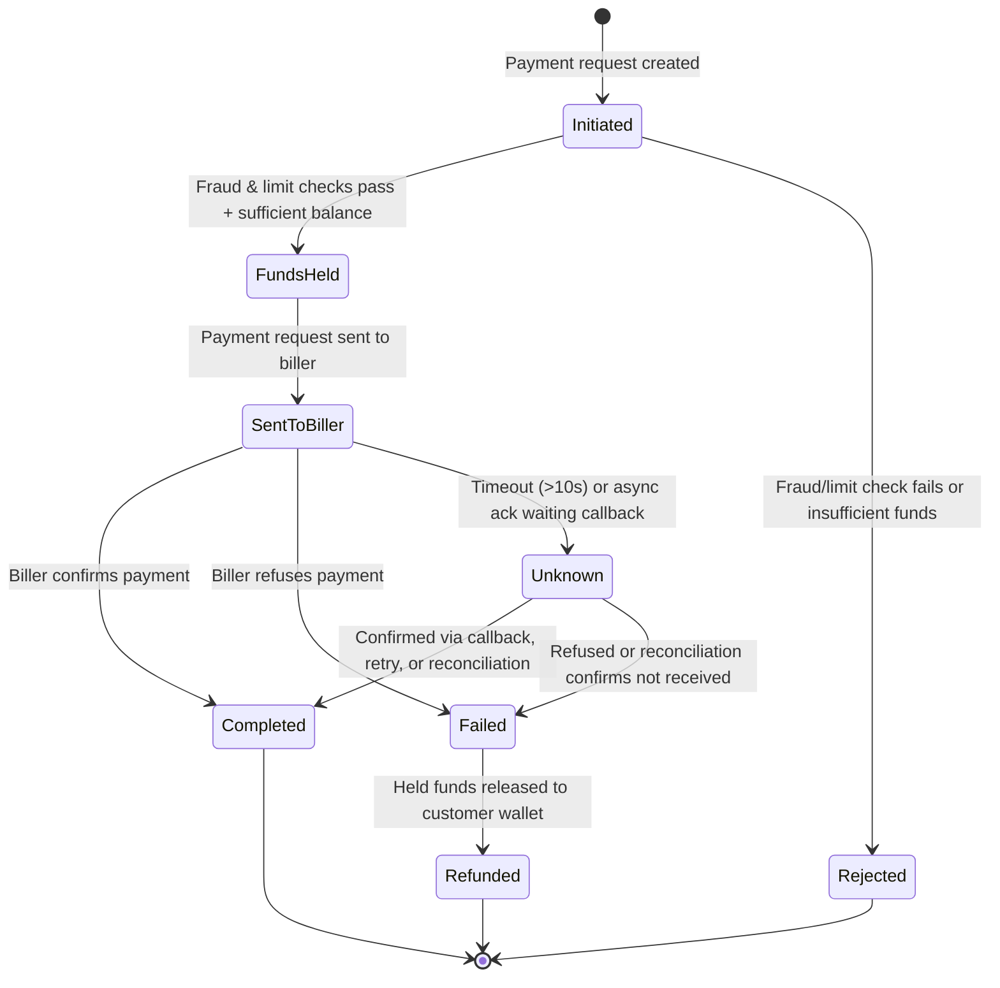

# مخططات نظام PayLink (UML Diagrams in Mermaid)

يحتوي هذا الملف على جميع مخططات النظام بصيغة **Mermaid** الجاهزة للعرض المباشر على GitHub أو Notion أو Mermaid Live Editor:
1. **Use Case Diagram:** مخطط حالات الاستخدام لجميع الأدوار.
2. **Sequence Diagram (Pay a Bill):** مخطط التسلسل لسيناريو دفع الفاتورة.
3. **Sequence Diagram (Failed Payment Release):** مخطط التسلسل لسيناريو استرجاع مبلغ عملية فاشلة.
4. **State Diagram:** مخطط الحالات لدورة حياة الدفع والانتقالات المسموحة فقط.

---

## 1. Use Case Diagram (مخطط حالات الاستخدام لجميع الأدوار)

---

## 2. Sequence Diagram — سيناريو 1: دفع الفاتورة (Pay a Bill)

---

## 3. Sequence Diagram — سيناريو 2: استرجاع مبلغ عملية فاشلة (Failed Payment Release)

---

## 4. State Diagram — حالات الدفع والانتقالات المسموحة فقط (Payment Lifecycle)

